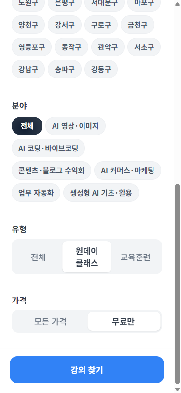
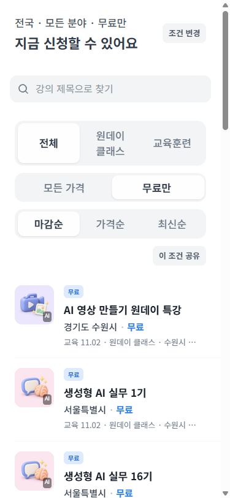
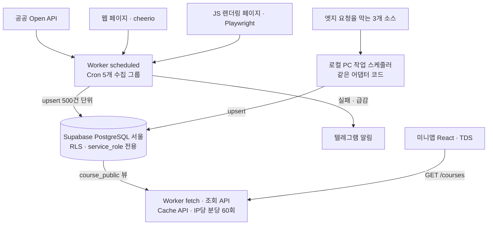
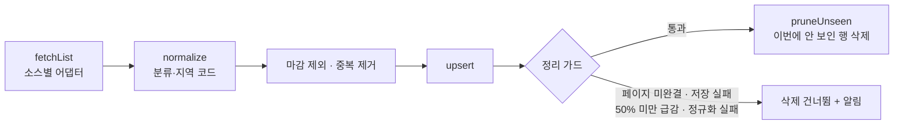

# N잡 배움터

> 공공 API와 웹 페이지에 흩어진 AI 교육을 매일 모아, 지역·분야별로 찾아 주는 토스 미니앱. 소스 하나가 실패해도 기존 데이터를 지우지 않는 수집 파이프라인이 핵심입니다.

[](https://github.com/YoungkeunAhn/njob-edu-collector/actions/workflows/ci.yml)


<p>
  
  
</p>

- **서비스**: 고용24, 지자체 평생학습 포털, 민간 사이트의 AI 활용 교육을 모아 원문 링크로 연결합니다. 토스 앱 안의 미니앱 플랫폼(앱인토스)에 2026.10 출시해 운영 중입니다.
- **이 저장소**: 운영 저장소에서 진행 중 작업 메모(`backlogs/`)만 빼고 옮긴 공개본입니다. Worker·앱·DB 마이그레이션·설계 문서가 모두 들어 있고, 테스트는 이 저장소만으로 전부 돌아갑니다.
- **담당**: 소스 조사, 수집 설계, DB 스키마, 조회 API, 토스 로그인·푸시 연동, 운영. 구현에는 Claude Code를 썼습니다([개발 방식](#개발-방식)).

## 핵심 설계 세 가지

1. **정리 가드** — 사라진 강좌를 지우는 정리는 수집 결과를 믿을 수 있을 때만 돕니다. 페이지를 끝까지 못 받았거나, 저장이 실패했거나, 건수가 직전 성공의 절반 미만이거나, 정규화 실패 행이 있으면 지우지 않습니다.
2. **실행 위치를 소스별로** — Open API·HTML·헤드리스 15개 소스 중 12개는 Worker Cron(9개 매일·3개 주 1회), 엣지(Cloudflare)에서 나가는 요청을 막는 3개는 로컬 PC 작업 스케줄러가 같은 어댑터 코드로 매일 수집합니다.
3. **DB는 Worker만** — 모든 테이블에 RLS를 켜고 정책을 두지 않았습니다. 앱은 DB에 직접 붙지 않고 Worker 조회 API만 부르며, 조회·찜 API에 응답 캐시와 IP당 분당 60회 제한이 걸립니다(이미지 프록시 `/img`는 아직 예외 — [#3](https://github.com/YoungkeunAhn/njob-edu-collector/issues/3)).

## 구조



| Cron (UTC) | KST | 소스 | 수집 방식 |
|---|---|---|---|
| `0 18 * * *` | 03:00 | 고용24 | HTML · cheerio |
| `10 18 * * *` | 03:10 | 서울시 공공서비스예약, 대구, K-Startup | Open API |
| `20 18 * * *` | 03:20 | 서울시평생학습포털, SeSAC, 데브이벤트, 링커리어 | HTML · cheerio |
| `40 18 * * *` | 03:40 | AI디지털배움터 | 헤드리스 Playwright |
| `30 19 * * SUN` | 월 04:30 | 평생학습 표준데이터, K-MOOC, 온통청년 | Open API |
| 작업 스케줄러 | 03:30 | 잡아바, 주변애, 더팀스 | 로컬 PC |

스케줄은 [`worker/src/sources/index.ts`](worker/src/sources/index.ts)와 [`worker/wrangler.toml`](worker/wrangler.toml)에 있고, 둘과 [설계 문서](docs/06-스펙/plan.md)의 표가 서로 같은지 테스트가 확인합니다.

## 정리 가드



| 조건 | 코드 | 테스트 |
|---|---|---|
| 페이지 미완결: 총건수 없음·페이지마다 총건수 다름·중간 빈 페이지·반복 페이지·상한 초과 → throw | [`collectPages`](worker/src/sources/util.ts#L44-L74) | `collectPages: 중간의 짧은 페이지는 계속, 총건수 없음·부분 응답·상한 초과는 throw` |
| 직전 성공 대비 50% 미만 | [`shouldPrune`](worker/src/core/rules.ts#L25) · [`runSource`](worker/src/collect/run.ts#L81-L84) | `T4-3 성공이지만 직전 대비 50% 미만이면 prune 건너뛰고 알림` |
| 정규화 실패 행 존재 | [`runSource`](worker/src/collect/run.ts#L65-L84) | `T4-4 normalize 예외 행만 버리고 나머지는 저장, 그 실행은 정리하지 않는다` |
| 수집 실패 | [`runSource`](worker/src/collect/run.ts#L55-L100) | `T4-2 실패 소스는 ok=false·error 기록, prune 안 함` |
| 저장(upsert) 일부 실패 | [`runSource`](worker/src/collect/run.ts#L55-L100) · [`supabase-repo.ts`](worker/src/collect/supabase-repo.ts) — throw → 정리 건너뜀, 실패 기록 | 직접 주입 테스트 없음 ([#5](https://github.com/YoungkeunAhn/njob-edu-collector/issues/5)) |
| 총건수를 주지 않는 소스 | 소스별 `prune: false` | `총건수를 확인할 수 없는 소스만 prune=false` |

DB 트리거는 `last_seen_at`이 과거로 돌아가지 않게 하고, 사람이 고친 분류를 덮어쓰지 않게 막습니다([`course_triggers.sql`](supabase/migrations/20261011000003_course_triggers.sql)).

## 기술적 의사결정

| 결정 | 검토한 대안 | 채택 | 근거 |
|---|---|---|---|
| 수집 실행 위치 | GitHub Actions / Vercel Hobby / Oracle 무료 VM에 DB까지 | 조회 API와 같은 Worker의 Cron | Actions는 서비스 일부 용도가 약관상 애매하고 cron 지연, Vercel Hobby는 상업 이용 불가·300초 제한, VM은 DB·백업·TLS 직접 운영. Worker는 Browser Rendering을 함께 씀 |
| 앱의 DB 접근 | anon 키 + RLS로 PostgREST 직접 호출 | Worker 조회 API만 공개 | DB 키·테이블 구조를 숨기고 캐시·요청 제한을 한곳에서 적용 |
| DB | Neon / Cloudflare D1 / MySQL + Hyperdrive | Supabase 서울 | Neon 서울 리전 없음, D1은 SQLite·서울 지정 불가, MySQL은 별도 호스팅 |
| 엣지 차단 소스 | 수집 중단 / GitHub Actions로 이전 | 로컬 PC 작업 스케줄러 | 중단하면 강좌 200여 건 손실, Actions 러너 IP도 막힐 수 있음 |
| 고용24 커리큘럼 | 매일 상세까지 수집(1,200여 건 × 약 400KB) | 열람 시 조회, 저장 안 함, 6시간 캐시 | 매일 받는 양 대비 열람 빈도 |
| 강좌 분류 | LLM 분류 | 키워드 룰 | 비용 0, 같은 입력에 같은 결과, 테스트로 고정 가능 |

결정 기록 전체(D1~D20)는 [`docs/06-스펙/plan.md`](docs/06-스펙/plan.md#결정-기록), 인프라 비교는 [`docs/05-아키텍처/인프라-서비스-스펙비교.md`](docs/05-아키텍처/인프라-서비스-스펙비교.md), 크롤링 법적 검토는 [`docs/03-데이터수집/크롤링-법적-이슈.md`](docs/03-데이터수집/크롤링-법적-이슈.md)에 있습니다.

## 트러블슈팅

| 문제 | 원인 | 해결 |
|---|---|---|
| 3개 소스가 엣지에서만 실패 | 오류에 `HTTP 403 host`만 남아 원인 불명 → 응답 `server` 헤더·본문 앞 120자를 기록하자 Cloudflare 봇 차단·웹방화벽으로 갈림 | 로컬 PC 수집으로 분리 |
| 헤드리스 수집이 엣지에서 60초 초과 | `networkidle` 62.8초, `load` 62.7초, `domcontentloaded` 4.0~4.4초 (엣지 재현) | `domcontentloaded` 후 사이트 함수 준비만 대기, 총건수 변경 시 1회 재수집 → 엣지에서 5,338건 81초 |
| 부분 실패가 데이터를 지울 위험 | 같은 `source_id` 중복으로 upsert 거부, 깨진 링크 9건으로 정리가 매일 건너뜀 | 배치 내 중복 제거, 정리 가드, 깨진 링크는 기관 포털로 대체 |
| Cron 실행 시간 | 고용24 드라이런 전체 591초 | 고용24를 별도 그룹(03:00)으로 분리 |

원인 분석과 재현 과정은 [`docs/troubleshooting.md`](docs/troubleshooting.md)에 정리했습니다.

## 실행과 테스트

```bash
npm ci
npm test            # Vitest 412개 (Worker + 앱). DB 테스트는 PGlite로 실제 마이그레이션을 적용해 돈다
npm run typecheck
```

외부 키 없이 실응답 픽스처와 PGlite로 돕니다.

- **실사이트 드라이런** `npm run dry-run -w worker`: 실제 사이트에서 받아 정규화까지 하되 메모리 저장소에 담아 DB에 쓰지 않습니다. 인자 없이 돌리면 키가 필요 없는 8개 소스만 돕니다. 공공 API 소스는 이름을 인자로 넘기고 [`worker/.dev.vars.example`](worker/.dev.vars.example)을 `worker/.dev.vars`로 복사해 키를 넣어야 하며, 헤드리스 소스(AI디지털배움터)는 Browser Rendering 바인딩이 필요해 여기서 돌지 않습니다.
- **실제 수집** `npm run collect-local -w worker`: Supabase에 씁니다. `worker/.dev.vars`에 `SUPABASE_URL`·`SUPABASE_SERVICE_ROLE_KEY`가 필요합니다.

## 개발 방식

구현은 Claude Code로 하고, 방향과 검증은 직접 정합니다. [`docs/08-AI워크플로우/`](docs/08-AI워크플로우)와 [`.claude/`](.claude)에 있는 스킬은 이슈 → 실행 계획 → 구현·리뷰 → 배포 → 검수 요청 단계를 묶은 것이고, 제가 확인하는 곳은 실행 계획 승인, 배포 후 실기기 확인, 토스 검수 요청입니다. 검수 요청은 hook이 막아 두어 제가 승인해야만 나갑니다. 문서의 "사용자"는 제 결정을 뜻합니다.

직접 판단한 예:
- 엣지에서 차단되는 소스를 우회하지 않고 실행 위치만 로컬 PC로 옮겼습니다. 수집 중단(200여 건 손실)과 GitHub Actions 이전(러너 IP도 막힐 수 있음)을 비교한 결과입니다([plan.md D20](docs/06-스펙/plan.md#결정-기록)).
- 분류에 LLM을 쓰지 않고 키워드 룰로 정했습니다. 같은 입력에 같은 결과가 나와야 테스트로 고정할 수 있어서입니다.

## 알려진 결함

코드 리뷰에서 찾았고, 운영 저장소에서 고친 뒤 이 저장소에 반영할 예정입니다.

- [#1](https://github.com/YoungkeunAhn/njob-edu-collector/issues/1) 토스 연결 해제 후 재로그인하면 해제 전 세션 토큰이 다시 유효해짐 — 토큰에 연결 버전이 없음
- [#2](https://github.com/YoungkeunAhn/njob-edu-collector/issues/2) 찜 50개 한도가 동시 요청에서 지켜지지 않음 — 개수 조회와 추가가 분리됨
- [#3](https://github.com/YoungkeunAhn/njob-edu-collector/issues/3) `/img` 경로가 요청 제한을 거치지 않음
- [#4](https://github.com/YoungkeunAhn/njob-edu-collector/issues/4) 같은 소스의 실행이 겹치면 늦게 끝난 실행이 최신 결과를 되돌릴 수 있음 — 지금은 Cron 시각이 그룹마다 다르고 그룹 안은 순차라 정상 운영에서는 겹치지 않음
- [#5](https://github.com/YoungkeunAhn/njob-edu-collector/issues/5) upsert 일부 배치 실패 경로를 직접 검증하는 테스트 없음

## 저장소 구성

```
worker/src/sources/   소스별 어댑터 15개 + collectPages
worker/src/collect/   수집 실행, upsert·정리, 텔레그램 알림
worker/src/api/       조회 API (캐시, 요청 제한, CORS)
worker/src/me/        토스 로그인(mTLS) · HMAC 세션 · 찜 · 마감 알림
worker/scripts/       드라이런, 로컬 수집
supabase/migrations/  스키마, RLS, 트리거, 뷰
app/                  미니앱 (React · 토스 TDS)
docs/                 소스 조사, 수집 설계, 아키텍처, 스펙·결정 기록, 운영 런북, AI 개발 워크플로우
.claude/              이슈 → 계획 → 구현 → 배포 → 검수 요청 스킬과 검수 hook 게이트
```

## 한계와 다음 과제

- 엣지 차단 소스 3곳은 PC 한 대에 기대고 있어, PC가 꺼진 날은 데이터가 낡습니다. 마지막 성공 시각이 오래되면 알리는 장치가 먼저 필요합니다.
- 운영 배포와 DB 마이그레이션은 런북([`docs/07-운영/배포-런북.md`](docs/07-운영/배포-런북.md))대로 수동입니다. CI는 이 공개본에 처음 붙였습니다.
- 정리 가드의 "50% 미만 급감"은 경험칙입니다. 페이지 완결성 검사가 없는 소스는 삭제 자체를 꺼서 보완합니다.
- 소스 간 같은 강좌를 아직 합치지 못합니다.
